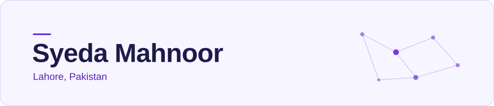

<picture>
  <source media="(prefers-color-scheme: dark)" srcset="./assets/header-dark.svg">
  <source media="(prefers-color-scheme: light)" srcset="./assets/header-light.svg">
  
</picture>

<h3>Software Engineering Student · Full-Stack Developer · Applied AI</h3>

I build full-stack products and AI systems that show their evidence: grounded answers, server-side checks, and clearly documented limits.

  <a href="https://syeda-mahnoor-portfolio-nine.vercel.app"><b>Portfolio</b></a>
  &nbsp;·&nbsp;
  <a href="https://linkedin.com/in/syeda-mahnoor-sm"><b>LinkedIn</b></a>
  &nbsp;·&nbsp;
  <a href="#featured-projects"><b>Projects</b></a>

 

## About

I'm a Software Engineering student at **Lahore Garrison University**, based in Lahore, Pakistan. I work across the stack, from React and Next.js frontends to Node.js and FastAPI services backed by PostgreSQL and MongoDB, and I increasingly build **applied AI**: retrieval-augmented generation, agent workflows with LangGraph and n8n, computer vision, and speech.

I care about software that is honest about what it knows. My projects cite their sources, keep scoring and grading on the server, and write down their limitations.

- **Focus:** full-stack web applications · RAG and agentic workflows · applied ML
- **Open to:** opportunities in full-stack development, AI/ML, and software engineering

## Featured Projects

<table>
<tr>
<td width="50%" valign="top">

### CyberSage

Cybersecurity AI assistant that shows its sources

Answers questions on cybersecurity policy and NIST guidance with citations to the exact PDF page, and declines when the evidence is thin.

- LangGraph agent that routes between RAG and risk scoring
- pgvector retrieval with quote and citation checks
- Tested with pytest, Vitest, Playwright, and axe

Next.js · FastAPI · LangGraph · PostgreSQL · pgvector · Groq

[Repository](https://github.com/syedamahnoor-sm/cybersage) · [Demo guide](https://github.com/syedamahnoor-sm/cybersage/blob/main/docs/demo-guide.md)

</td>
<td width="50%" valign="top">

### BugLab

Debugging practice built on simulated production incidents

Learners read code, logs, and network traffic to trace a simulated outage, then submit a root-cause diagnosis that the server grades.

- 30 challenges, with answer keys kept on the server
- Monaco workspace with logs, network, and notes
- Two-person team: I owned product and frontend

Next.js · TypeScript · Monaco · Better Auth · PostgreSQL

[Repository](https://github.com/syedamahnoor-sm/buglab) · [Live demo](https://buglab-one.vercel.app)

</td>
</tr>
<tr>
<td width="50%" valign="top">

### PresentAI Coach

Presentation coaching with vision, speech, and agentic AI

Analyzes posture, gestures, eye contact, and speech from a live camera session or an uploaded video, then turns the results into coaching.

- Posture model: 74.7% accuracy, 80.7% ROC-AUC
- Faster-Whisper pace and filler-word analysis
- LangGraph and Gemini coach that critiques its own advice

Python · MediaPipe · OpenCV · scikit-learn · LangGraph · Streamlit

[Repository](https://github.com/syedamahnoor-sm/PresentAI-Coach) · [Live demo](https://presentai-coach.streamlit.app)

</td>
<td width="50%" valign="top">

### EventNexus

Campus event platform for students and organizers

Students discover and register for university events. Organizers publish events, build registration forms, and manage participants.

- Session auth, CSRF protection, and role checks
- MongoDB transactions for seat reservations
- Custom registration form builder

React · Express · MongoDB · Mongoose · Tailwind CSS

[Repository](https://github.com/syedamahnoor-sm/EventNexus) · [Live demo](https://event-nexus-one.vercel.app)

</td>
</tr>
</table>

### More Projects

| Project | What it does | Built with |
| :-- | :-- | :-- |
| [**MeritLens**](https://github.com/syedamahnoor-sm/meritlens) | RAG recruitment assistant that assesses resumes against job requirements, with human review kept in the loop | n8n · Gemini · PostgreSQL + pgvector · Docker |
| [**Connectify**](https://github.com/syedamahnoor-sm/Connectify) · [Live demo](https://connectify-gray.vercel.app) | Social platform with posts, follows, and real-time chat and notifications | React · Node.js · MongoDB · Socket.io · Cloudinary |
| [**Ember Studio**](https://github.com/syedamahnoor-sm/higgsfield-reimagined) · [Live demo](https://higgsfield-reimagined.vercel.app) | Creative-AI product redesign organized around creator workflows, with image, voice, and transcription | Next.js · TypeScript · Tailwind · Cloudflare Workers AI |
| [**SpecWise**](https://github.com/syedamahnoor-sm/specwise-ai) | Requirements-engineering API that interviews users with Gemini-generated clarification questions *(in progress)* | n8n · Gemini · PostgreSQL |
| [**FlowPilot**](https://github.com/syedamahnoor-sm/flowpilot-ai) | Team workflow automation for blocker analysis, overdue reminders, and weekly AI progress reports | n8n · Gemini · Google Sheets · Gmail |
| [**VidSnapAI**](https://github.com/syedamahnoor-sm/VidSnapAI) | Turns images and text prompts into narrated vertical reels | Flask · SQLite · Edge-TTS · FFmpeg |
| [**California House Prices**](https://github.com/syedamahnoor-sm/california-house-price-prediction) | Regression pipeline with preprocessing, cross-validation, and Random Forest | scikit-learn · pandas · NumPy |

## Tech Stack

| Area | Tools |
| :-- | :-- |
| **Languages** | Python · TypeScript · JavaScript · SQL · C++ |
| **Frontend** | React · Next.js · Tailwind CSS · Vite |
| **Backend** | Node.js · Express · FastAPI · Flask · REST APIs · Socket.io |
| **Data** | PostgreSQL · pgvector · MongoDB · SQLite |
| **Applied AI** | RAG · LangGraph · Gemini · Groq · Sentence Transformers · Faster-Whisper |
| **ML & Vision** | scikit-learn · MediaPipe · OpenCV · pandas · NumPy |
| **Automation & Delivery** | n8n · Docker · Vercel · Render · Streamlit Cloud |
| **Testing** | Playwright · Vitest · pytest · node:test |

  <picture>
    <source media="(prefers-color-scheme: dark)" srcset="https://skillicons.dev/icons?i=py%2Cts%2Cjs%2Creact%2Cnextjs%2Cnodejs%2Cexpress%2Cfastapi%2Cpostgres%2Cmongodb%2Cdocker%2Ctailwind&theme=dark">
    <source media="(prefers-color-scheme: light)" srcset="https://skillicons.dev/icons?i=py%2Cts%2Cjs%2Creact%2Cnextjs%2Cnodejs%2Cexpress%2Cfastapi%2Cpostgres%2Cmongodb%2Cdocker%2Ctailwind&theme=light">
    
  </picture>

## Experience & Education

- **Experience:** MERN Stack Intern, Falcon Nova Solutions *(formerly Falcon Solutions Pvt. Ltd.)*
- **Education:** Software Engineering, Lahore Garrison University

## Connect

I'm happy to talk about full-stack development, applied AI, or opportunities to build together.

[Portfolio](https://syeda-mahnoor-portfolio-nine.vercel.app) · [LinkedIn](https://linkedin.com/in/syeda-mahnoor-sm) · [GitHub](https://github.com/syedamahnoor-sm)
